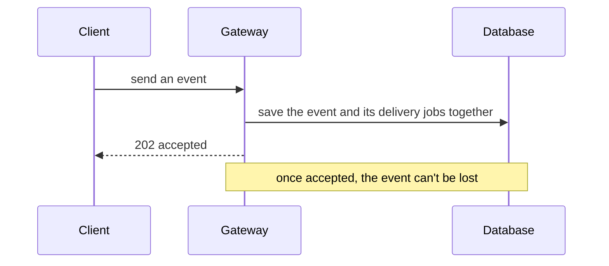

# ferrum-webhook-gateway

The API of **Ferrum**, a service that delivers webhooks reliably. This is the part people send events to. It checks who they are, saves each event safely, and shows what happened to it.
The part that actually delivers the events is [`ferrum-webhook-worker`](https://github.com/pratishtha-abrol/ferrum-webhook-worker).



## What you can do with it

| | Endpoints |
|---|---|
| Accounts | `POST /register`, `POST /login` |
| Register where events should go | `POST/GET /webhooks`, `GET/PATCH/DELETE /webhooks/{id}` |
| Send and look up events | `POST /events`, `GET /events`, `GET /events/{event_id}` |
| See what happened, and re-send | `GET /deliveries`, `GET /deliveries/{event_id}`, `POST /retry/{event_id}` |
| Health and metrics | `GET /healthz`, `GET /readyz`, `GET /metrics` |

Sending the same request twice counts once (`Idempotency-Key`). Everyone sees only their own data. Private network addresses are refused as webhook URLs. When overloaded, it answers `503` with a retry hint instead of hanging.
Full reference: [API docs](https://github.com/pratishtha-abrol/ferrum/blob/main/docs/api.md).

## Run it

```bash
python3 -m venv .venv && .venv/bin/pip install -r requirements.txt
cp .env.example .env            # fill in JWT_SECRET (32+ characters) and the database settings
.venv/bin/python -m alembic upgrade head
.venv/bin/python -m uvicorn app.main:app --port 8000
```
The easiest full setup (database, Redis, API and worker in one command) is `infra/local/stack.sh up` in the [`infra`](https://github.com/pratishtha-abrol/infra) repository.

## Tests

```bash
.venv/bin/python -m pytest -q        # 37 tests, no database needed
```
To also run the 4 tests that need a real PostgreSQL, set `TEST_DATABASE_URL` to a throwaway database whose name contains `test` (its tables are wiped).

## Code map

```
app/main.py         the endpoints                      app/crud/         database access
app/security.py     logins and passwords               app/ssrf.py       the private-address check
app/ratelimit.py    request limits                     app/db.py         database connection
alembic/            database setup (this service owns the schema)
```
Settings: `.env.example`, and [all options](https://github.com/pratishtha-abrol/ferrum/blob/main/docs/configuration.md). If you change `app/models.py`, copy it into the worker repository too.

MIT licensed.
